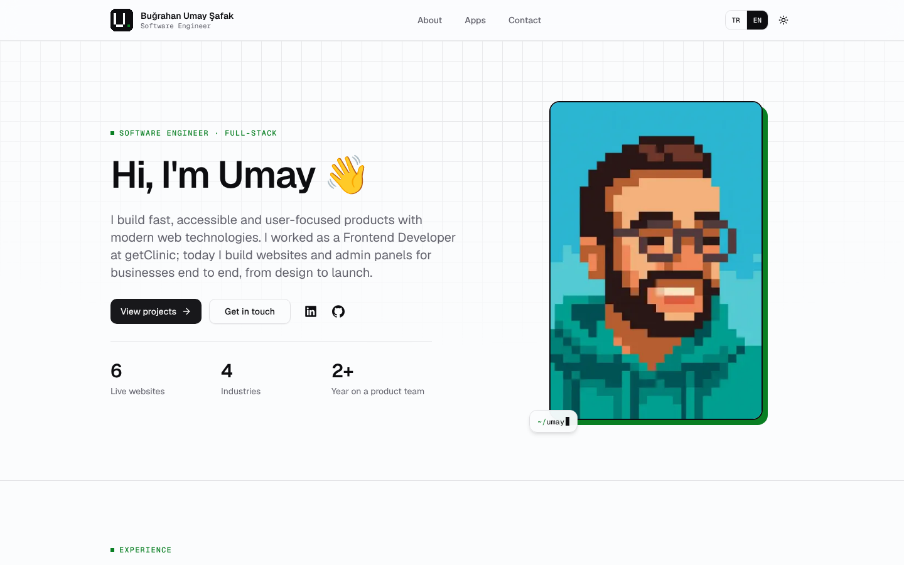

<h1 align="center">bugrahanumaysafak-portfolio</h1>

<p align="center">
  Personal portfolio of <b>Buğrahan Umay Şafak</b>, Full-Stack Developer.<br />
  Built with Next.js 16, React 19, TypeScript, next-intl, Tailwind CSS 4 and shadcn/ui.
</p>

<p align="center">
  <a href="https://bugrahanumaysafak-portfolio.vercel.app"><b>🌐 bugrahanumaysafak-portfolio.vercel.app</b></a>
  ·
  <a href="https://www.linkedin.com/in/bugrahanumaysafak">LinkedIn</a>
  ·
  <a href="#-türkçe-geliştirici-notları">🇹🇷 Türkçe</a>
</p>

<p align="center">
  
  
  
  
  
</p>

<picture>
  <source media="(prefers-color-scheme: dark)" srcset=".github/assets/home-dark.png" />
  
</picture>

## ✨ Features

- **Bilingual (EN / TR):** locale-prefixed routes (`/en`, `/tr`) with next-intl; `hreflang` and `x-default` on every page
- **Home page:** hero → experience → projects (freelance + full-time) → technologies → certifications → apps (coming soon) + contact
- **Project detail pages** (`/projects/[slug]`) with a screenshot gallery in desktop and mobile device frames
- **SEO:** canonical URLs, sitemap, robots.txt, schema.org JSON-LD (`WebSite`, `Person`, `ProfilePage`, `BreadcrumbList`) and build-time PNG Open Graph images for the site and every project
- **UI:** shadcn/ui (Radix) components, light/dark theme with a circular reveal transition, page transitions with React `<ViewTransition>`, scroll-driven reveal animations
- **Accessibility:** every animation is disabled when `prefers-reduced-motion` is on
- **React Compiler** and security headers enabled in `next.config.ts`
- **Data-driven content:** projects, experience, technologies and certifications live in typed files under `src/data/`

## 🧰 Tech Stack

| Area | Tools |
| --- | --- |
| Framework | Next.js 16 (App Router, Turbopack), React 19, React Compiler |
| Language | TypeScript |
| Styling & UI | Tailwind CSS 4, shadcn/ui (Radix UI), lucide-react, react-icons, Embla Carousel, Sonner |
| i18n | next-intl |
| Tooling | pnpm, ESLint |

## 🚀 Getting Started

Requirements: **Node.js 20+** and **pnpm** (the version is pinned in the `packageManager` field of `package.json`; run `corepack enable` to use it automatically).

```bash
pnpm install     # install dependencies
pnpm dev         # dev server → http://localhost:3000
pnpm build       # production build
pnpm start       # production server
pnpm lint        # ESLint
pnpm typecheck   # TypeScript type check
```

## 📁 Project Structure

```text
src/
├── app/            # routes: [locale]/ (home, about, projects/[slug], contact, apps), sitemap, robots, OG images
├── components/     # shared components (header, footer, project card, experience timeline, ui/ = shadcn/ui)
├── config/site.ts  # name, production URL and contact channels
├── data/           # projects, experience, technologies, certifications
├── features/       # page-level components
├── i18n/           # next-intl routing and request config
├── lib/            # metadata, structured data, OG image, helpers
├── styles/         # globals.css (theme tokens, animations)
└── proxy.ts        # next-intl locale routing (Next.js 16: middleware → proxy)
messages/           # UI translations (en.json, tr.json)
public/             # portrait, certificates, project screenshots (public/works/<project>/)
```

## ✏️ Editing Content

| What | Where |
| --- | --- |
| Personal info, site URL, contact channels | `src/config/site.ts` |
| Projects (detail page, OG image and sitemap entry are generated automatically) | `src/data/projects.ts` |
| Experience timeline | `src/data/experience.ts` |
| Technologies | `src/data/technologies.ts` |
| Certifications | `src/data/certifications.ts` |
| UI texts | `messages/en.json`, `messages/tr.json` |

## 📄 License

No open-source license is granted: the code is public for reference only, and all rights are reserved. The portrait, personal photos, certificates, client logos and project screenshots may not be reused.

---

## 🇹🇷 Türkçe geliştirici notları

Next.js (App Router) + next-intl + Tailwind CSS ile hazırlanmış kişisel portföy sitesi — [bugrahanumaysafak-portfolio.vercel.app](https://bugrahanumaysafak-portfolio.vercel.app).


### Gereksinimler

- Node.js 20+
- [pnpm](https://pnpm.io) (sürüm `package.json` içindeki `packageManager` alanında sabit; `corepack enable` ile otomatik kullanılabilir)

### Komutlar

```bash
pnpm install     # bağımlılıkları kur
pnpm dev         # geliştirme sunucusu → http://localhost:3000
pnpm build       # production build
pnpm start       # production sunucusu
pnpm lint        # ESLint
pnpm typecheck   # TypeScript tip kontrolü
```

> Install script çalıştırmasına izin verilen paketler `pnpm-workspace.yaml` içindeki `allowBuilds` listesinde tutulur. Yeni bir paket eklerken pnpm uyarı verirse `pnpm approve-builds` ile onaylayabilirsin.

### Yapı

- `src/app/[locale]/` — dil önekli sayfalar (`/en`, `/tr`): ana sayfa, `about`, `projects/[slug]` (proje detayları), `contact`, `apps`. Projeler ve teknolojiler ana sayfada; eski `/projects` ve `/technologies` adresleri ana sayfadaki bölümlere kalıcı olarak yönlenir (`next.config.ts`).
- `src/app/og.png/`, `src/app/og/projects/[file]/` — paylaşım (Open Graph) görselleri; build sırasında PNG olarak üretilir
- `src/app/sitemap.ts`, `src/app/robots.ts` — sitemap ve robots.txt
- `src/features/` — sayfa bazlı bileşenler
- `src/components/` — ortak bileşenler (header, footer, proje kartı, deneyim zaman çizelgesi, sertifikalar, cihaz çerçeveleri, logo…)
- `src/lib/metadata.ts` — sayfa metadata'sı (canonical, hreflang, Open Graph)
- `src/lib/structured-data.ts` — schema.org yapılandırılmış verisi (JSON-LD)
- `src/proxy.ts` — next-intl dil yönlendirmesi (Next.js 16'da `middleware` → `proxy`)
- `src/components/ui/` — shadcn/ui bileşenleri (CLI ile eklenir: `pnpm dlx shadcn@latest add <bileşen>`)
- `messages/` — arayüz metinlerinin çevirileri (`tr.json`, `en.json`)
- `public/works/<proje>/` — projelerin ekran görüntüleri (masaüstü 1440×900, mobil 390×844)
- `public/certificates/` — sertifika görselleri ve PDF'leri
- `public/pixel.webp` — ana sayfadaki piksel portre; `public/bugrahanumaysafak.JPEG` — Hakkımda sayfasındaki fotoğraf (uzantı büyük harfle; sunucu büyük/küçük harfe duyarlı olduğundan kodda da birebir böyle kullanılıyor)

#### Ana sayfa bölüm sırası

Hero → Deneyim (şirketler) → Projeler (freelance + tam zamanlı) → Teknolojiler (kategorilere göre açılır listeler) → Sertifikalar → Mobil uygulamalar (Yakında) + İletişim. Sıra `src/features/home/containers/home-page-wrapper.tsx` içinde.

Header ve footer menüsü: Hakkımda, Uygulamalar, İletişim (`src/components/header/nav-items.ts`).

### Arayüz ve animasyonlar

- Arayüz bileşenleri **shadcn/ui** (Radix) ile kuruldu: Button, Card, Badge, Separator, Dialog, Sheet (mobil menü), NavigationMenu, ToggleGroup (dil seçici), Tooltip, Breadcrumb, Carousel (proje galerisi), Avatar, AspectRatio, Sonner (bildirimler).
- **Vurgu rengi:** yeşil; `src/styles/globals.css` içindeki `--brand` (açık ve koyu tema ayrı). Favicon (`src/app/icon.svg`) ve paylaşım görselleri (`src/lib/og-image.tsx`) aynı yeşili kullanır.
- **Sayfa geçişleri:** React `<ViewTransition>` (Next.js 16 + View Transitions API). Her sayfa `PageTransition` ile sarılır; header geçişte sabit kalır. Animasyonlar `globals.css` içinde (`page-enter` / `page-exit`).
- **Tema geçişi:** destekleyen tarayıcılarda tıklanan noktadan dairesel olarak yayılır (`theme-provider.tsx`).
- **Kaydırınca belirme:** `.reveal` sınıfı, CSS scroll-driven animasyon kullanır; desteklemeyen tarayıcılarda içerik doğrudan görünür.
- `prefers-reduced-motion` açıksa tüm animasyonlar kapanır.

### İçerik düzenleme

- **Kişisel bilgiler, site adresi ve iletişim kanalları:** `src/config/site.ts` (boş bırakılan kanallar gizlenir)
- **Projeler:** `src/data/projects.ts`. Her proje TR/EN içerik, teknolojiler, linkler ve galeri barındırır. Yeni proje eklendiğinde detay sayfası, paylaşım görseli ve sitemap kaydı otomatik oluşur.
- **Deneyim zaman çizelgesi:** `src/data/experience.ts`. Şirket logosu (`logo`) ve şirket sayfası (`companyUrl`) isteğe bağlıdır; teknolojiler, `projectSlugs` ile bağlanan projelerden otomatik derlenir.
- **Teknolojiler:** `src/data/technologies.ts`. Ana sayfada kategorilere göre açılır listelerde (native `<details>`; içerik kapalıyken de HTML'de kalır) gösterilir; kategori başlık ve açıklamaları `messages/*.json` → `Technologies`. `FEATURED_TECHNOLOGY_IDS`, yapılandırılmış verideki uzmanlık listesidir.
- **Sertifikalar:** `src/data/certifications.ts`. Listeye kayıt eklemek yeterli; `image`, `pdf`, `credentialId`, `credentialUrl`, `issuerIcon` ve `skills` isteğe bağlıdır, boş bırakılanlar arayüzde gösterilmez.
- **Mobil uygulamalar (Yakında) metinleri:** `messages/*.json` → `Apps`

### SEO

- **Site adresi:** `src/config/site.ts` içindeki `PRODUCTION_URL` (`https://bugrahanumaysafak-portfolio.vercel.app`). Canonical, hreflang, sitemap, robots, Open Graph ve yapılandırılmış veri bu adresle üretilir. Yerel geliştirmede `http://localhost:3000` kullanılır; farklı bir adres gerekirse `NEXT_PUBLIC_SITE_URL` ile ezilebilir. Vercel preview ortamları da canonical olarak production adresini gösterir.
- **hreflang:** her sayfada `en`, `tr` ve `x-default` (dil önekisiz adres; ziyaretçiyi tarayıcı diline göre yönlendirir).
- **Paylaşım görselleri:** `/og.png` (site geneli) ve `/og/projects/<slug>.png` (her proje). Ekran görüntüleri WebP olduğu ve bazı platformlar (ör. LinkedIn) WebP önizlemesini göstermediği için PNG olarak üretilir.
- **Yapılandırılmış veri (JSON-LD):** ana sayfada `WebSite` + `Person`, Hakkımda sayfasında `ProfilePage`, proje sayfalarında `BreadcrumbList`. Yalnızca sitede görünen gerçek bilgiler kullanılır.

### Yol haritası: mobil uygulamalar ve şahıs şirketi

Şu an yayınlanmış uygulama ve kurulmuş şirket yok; site kişisel portföy olarak çalışıyor. `/apps` yalnızca "Yakında" bilgisini gösterir. Aşağıdaki yapı, ihtiyaç doğduğunda eklenmek üzere planlandı — henüz kodlanmadı.

#### Planlanan adresler

| Adres | İçerik |
| --- | --- |
| `/apps` | Uygulama listesi (şu an "Yakında") |
| `/apps/[slug]` | Uygulamanın tanıtım sayfası, App Store / Google Play bağlantıları |
| `/apps/[slug]/privacy` | Gizlilik politikası (mağazalar için zorunlu) |
| `/apps/[slug]/terms` | Kullanım koşulları |
| `/apps/[slug]/support` | Destek ve iletişim (App Store için destek adresi zorunlu) |
| `/apps/[slug]/delete-account` | Hesap silme talebi (hesap oluşturulan uygulamalarda Google Play web üzerinden silme bağlantısı ister) |

#### İlk uygulama yayınlanırken

1. `src/data/apps.ts` oluştur: `slug`, `name`, TR/EN açıklama, ikon, mağaza bağlantıları, destek e-postası ve yasal metinlerin güncellenme tarihi gibi alanlar (projeler `src/data/projects.ts` ile aynı yaklaşım). Uygulamalar yazılım projelerinden ayrı tutulur.
2. `src/app/[locale]/apps/` altına yukarıdaki sayfaları ekle; `/apps` listesini bu veriden üret.
3. `src/app/sitemap.ts` içine uygulama sayfalarını ekle; uygulama sayfalarına `SoftwareApplication` yapılandırılmış verisi ekle.
4. Hesap silme sayfası gerçekten çalışan bir süreç sunmalı (ör. doğrulanmış bir talep formu veya destek e-postası üzerinden işlem). İşlevsiz bir sayfa yayınlanmamalı.

#### Şirket kurulduğunda

- Ticari unvan, vergi bilgileri, yasal adres ve ticari iletişim bilgileri `src/config/site.ts` içinde ayrı bir `business` alanında tutulmalı; footer, yasal sayfalar ve yapılandırılmış veri (`Organization`) bu tek kaynaktan beslenmeli.
- Türkiye'deki kullanıcılar için KVKK kapsamındaki aydınlatma metinleri de yasal sayfalara eklenmeli.
- Şirket gerçekten kurulana kadar sitede ticari işletme izlenimi veren bilgi ve yapılandırılmış veri yer almamalı.
